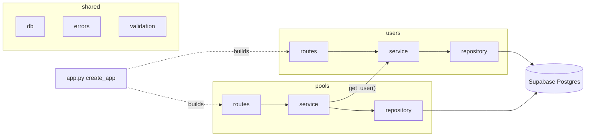
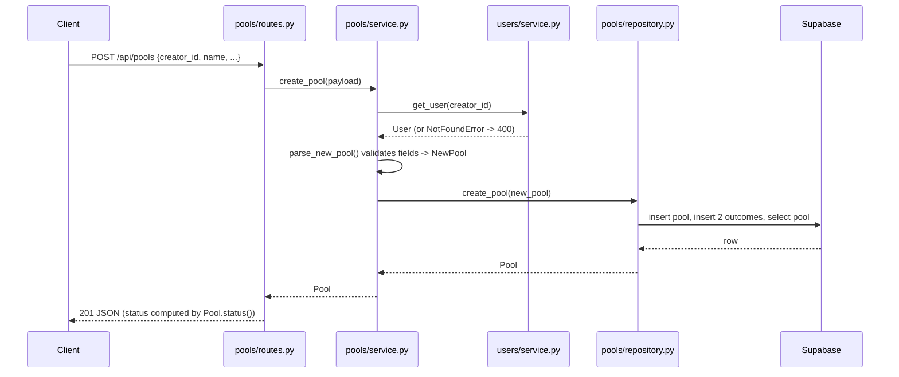

# Backend architecture

The backend is a **modular monolith**: one Flask app, one deployment, split into modules by business area. Each module has the same four files, so once you understand one module you understand all of them.

## Modules

```
backend/
├── app.py             # create_app(): builds everything and registers the routes
├── shared/            # code every module uses
│   ├── db.py          # Supabase client (refuses to start without credentials)
│   ├── errors.py      # ValidationError -> 400, NotFoundError -> 404, anything else -> 500
│   └── validation.py  # small input checks: JSON object, required text
├── users/             # people who create pools
│   ├── models.py
│   ├── service.py
│   ├── repository.py
│   └── routes.py
└── pools/             # two-option prediction pools
    ├── models.py
    ├── service.py
    ├── repository.py
    └── routes.py
```

| File | Responsibility | Knows about |
| :--- | :--- | :--- |
| `routes.py` | HTTP only: read the request, call the service, turn the result into JSON | Flask, its own service |
| `service.py` | Business rules: validation, defaults (decider = creator), talking to other modules | its own repository, other modules' services |
| `repository.py` | Database access with `supabase-py`. Rows are turned into dataclasses by hand | Supabase, its own models |
| `models.py` | Plain dataclasses (`User`, `Pool`, `Outcome`...), plus rules that only need the data itself (`Pool.status()`) | nothing |



## Dependency rules

1. **Inside a module, calls go one way:** `routes -> service -> repository`. A repository never calls a service, and a service never touches Flask's `request`.
2. **Between modules, only services talk.** `PoolService` asks `UserService.get_user()` for the creator. The pools module never reads the `users` table and never imports `users.repository`.
3. **`shared/` depends on no module.** Modules depend on `shared/`, never the other way around.
4. **Only `app.py` creates objects.** Services receive their repository (and other services) through the constructor. That is what lets the tests swap the database for a fake.

## Request flow: creating a pool



If any step raises `ValidationError` or `NotFoundError`, the error handlers in `shared/errors.py` turn it into a JSON response. Any other exception becomes a generic `500 {"error": "Internal server error."}`, and the details are only logged.

## Patterns, and where to find them

| Pattern | Where | Why |
| :--- | :--- | :--- |
| Layered modules (modular monolith) | `users/`, `pools/` | Each business area can grow on its own without a distributed system |
| Repository | `*/repository.py` | Services don't know how or where data is stored |
| Manual row mapping (Data Mapper idea, no ORM) | `_to_pool()` in `pools/repository.py` | The class forbids ORMs; mapping by hand keeps the SQL/table shape out of the models |
| Dependency injection (by constructor) | `create_app()` in `app.py` | Tests pass fake repositories, and production passes Supabase ones. No framework needed |
| Application factory | `create_app()` | Each test gets a fresh app; Gunicorn calls `app:create_app()` |
| Test double (fake) | `tests/fakes.py` | Acceptance tests run without a database (see [testing](iterations/0/i00.d004-testing.md)) |

## Decisions and tradeoffs

### 1. A modular monolith, not MVC or microservices

- **Chosen:** one app, split into modules by business area (`users`, `pools`).
- **Why:** a flat "all routes in one file" layout mixed HTTP, rules and SQL in the same functions. Microservices would add network calls and deployments for a three-endpoint app.
- **Cost:** module boundaries are a convention (rule 2 above), not enforced by the language. We keep them in code review.

### 2. Keep `supabase-py` instead of raw SQL with `psycopg`

- **Chosen:** `supabase-py`, which calls Supabase's REST API. It is a query builder, not an ORM: there are no mapped classes, no lazy loading, and no automatic saving.
- **Why:** it was already set up on Render and needs no new secret.
- **Cost:** two inserts (the pool, then its outcomes) cannot share a database transaction. If the outcomes insert fails, `create_pool` deletes the pool it just created. A crash in between could still leave a pool with no outcomes. Raw SQL with `psycopg` would solve this, and it is the first thing to change if it becomes a problem.

### 3. No in-memory fallback in the app

- **Before:** if Supabase was not configured, the app quietly stored pools in memory and lost them on restart.
- **Now:** the app refuses to start without `SUPABASE_URL` and `SUPABASE_KEY`, so a misconfigured deployment fails loudly instead of losing data.
- **The in-memory store still exists, but only as a test double** in `tests/fakes.py`.

### 4. An unknown `creator_id` is a 400, not a 404

The URL `/api/pools` exists; what is wrong is a field in the request body. A 404 would suggest the endpoint itself is missing.

### 5. No database changes

The tables from `backend/migrations/001_init.sql` are used as they are. The backend generates user ids (`users.id` has no default), and `is_guest` keeps its default.

## Adding a module in a later iteration (e.g. picks)

1. Create `backend/picks/` with `models.py`, `service.py`, `repository.py`, `routes.py`.
2. `PickService` receives a `PickRepository`, plus `PoolService` and `UserService` if it needs pools or users. It never reads their tables.
3. Build it in `create_app()` and register its blueprint.
4. Add a fake to `tests/fakes.py`, write the user story with acceptance criteria, and add one acceptance test per criterion.

## Not done yet (on purpose)

- **Picks and resolving pools.** The `picks` table exists in `001_init.sql` but no code uses it yet.
- **`002_create_pool_fn.sql`** (a stored procedure for atomic pool creation) is not used by the code. See decision 2.
- **Authentication.** Any client can create users and pools, which is acceptable for the Iteration 0 prototype.
- **Outcome order.** `GET /api/pools` does not guarantee that the two outcomes come back in the order they were created.

## Known configuration issue

Supabase row-level security rejects inserts (and appears to hide existing rows from reads) when `SUPABASE_KEY` is the **publishable** key. The backend must use the **`service_role`** key, both locally (`backend/.env`) and on Render. That key must never be sent to the frontend.
