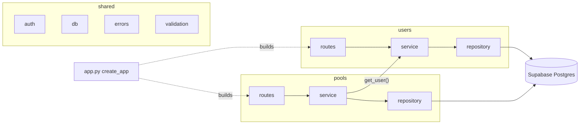
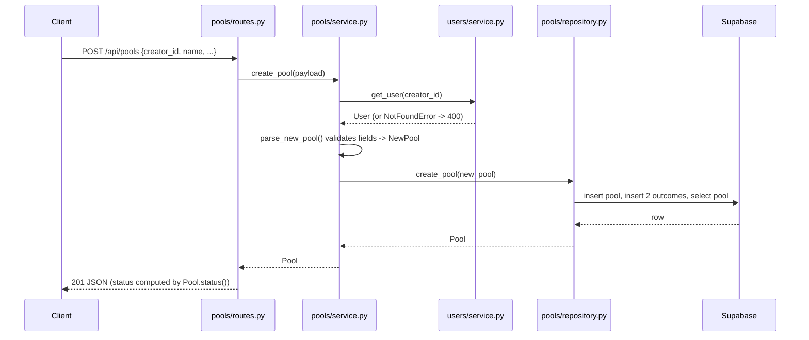
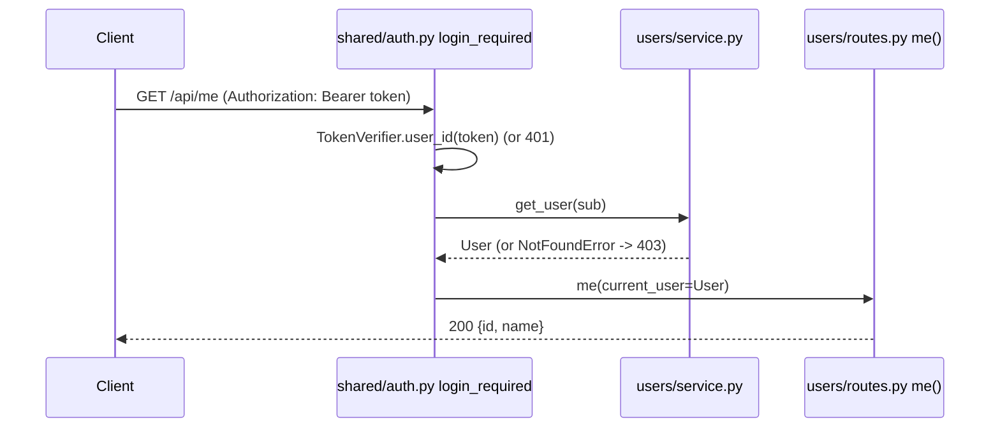

# Backend architecture

The backend is a **modular monolith**: one Flask app, one deployment, split into modules by business area. Each module has the same four files, so once you understand one module you understand all of them.

## Modules

```
backend/
├── app.py             # create_app(): builds everything and registers the routes
├── shared/            # code every module uses
│   ├── auth.py        # token verifier and @login_required guard (see "Who is calling")
│   ├── db.py          # Supabase client (refuses to start without credentials)
│   ├── errors.py      # ValidationError -> 400, AuthenticationError -> 401, ForbiddenError -> 403,
│   │                  # NotFoundError -> 404, anything else -> 500
│   └── validation.py  # small input checks: JSON object, required text
├── users/             # people who create pools
│   ├── models.py
│   ├── service.py
│   ├── repository.py
│   └── routes.py
└── pools/             # two-option prediction pools
    ├── models.py
    ├── service.py
    ├── repository.py
    └── routes.py
```

| File | Responsibility | Knows about |
| :--- | :--- | :--- |
| `routes.py` | HTTP only: read the request, call the service, turn the result into JSON | Flask, its own service and models |
| `service.py` | Business rules: validation, defaults (decider = creator), talking to other modules | its own repository, other modules' services |
| `repository.py` | Database access with `supabase-py`. Rows are turned into dataclasses by hand | Supabase, its own models |
| `models.py` | Plain dataclasses (`User`, `Pool`, `Outcome`...), plus rules that only need the data itself (`Pool.status()`) | Python standard library |



## Dependency rules

1. **Inside a module, calls go one way:** `routes -> service -> repository`. A repository never calls a service, and a service never touches Flask's `request`.
2. **Cross-module business behavior goes through services.** `PoolService` asks `UserService.get_user()` to validate the creator and never imports `users.repository`. The pool repository's read projection joins `users` to obtain creator/decider summaries. That is response mapping, not cross-module service logic.
3. **`shared/` depends on no module.** Modules depend on `shared/`, never the other way around.
4. **`app.py` wires application-wide services and repositories.** Services receive their repository (and other services) through the constructor. Routes and services can still construct request-scoped model objects. Constructor injection lets tests swap the database for a fake.


## Request flow: creating a pool



If any step raises `ValidationError` or `NotFoundError`, the error handlers in `shared/errors.py` turn it into a JSON response. Any other exception becomes a generic `500 {"error": "Internal server error."}`, and the details are only logged.

## Who is calling: token verifier and login guard

A logged-in Account's Supabase access token reaches Flask as `Authorization: Bearer <token>`. `shared/auth.py` has two parts:

- **`TokenVerifier`** checks the token locally (ADR 0001): ES256 signature against a trusted key, `exp` not passed, `aud == "authenticated"`. It returns the token's `sub`, which is the User's id. In production `TokenVerifier.from_env()` trusts the key set at `<SUPABASE_URL>/auth/v1/.well-known/jwks.json`; PyJWT's `PyJWKClient` fetches it on first use and caches it (refreshed at most every 5 minutes), so requests don't call Supabase. A token with an unknown `kid` (Supabase rotated its key) refetches the set, at most once every 30 seconds. If Supabase can't be reached when the set must be fetched, the request fails with a 500, not a 401: it is our failure, not the caller's.
- **`create_login_guard(verifier, load_user)`** builds the `@login_required` decorator. It reads the bearer token, verifies it, loads the User through `UserService.get_user()` and calls the route with `current_user=<User>`. `app.py` builds it once and hands it to any blueprint that needs it, so any route can be guarded, not just `/api/me`.

| Request | Response |
| :--- | :--- |
| No `Authorization` header, not `Bearer <token>`, or a token that is malformed, expired, for another audience or signed by another key | `401 {"error": "Authentication required."}` |
| Valid token, but no User with that id | `403 {"error": "No user exists for this account."}` |
| Valid token for an existing User | the route runs with that User |

`create_app()` takes the verifier as an injectable next to the repositories (`token_verifier=`). Acceptance tests generate a throwaway ES256 key pair, inject `TokenVerifier.for_public_key(<public half>)`, and sign real tokens with the private half (helpers in `tests/acceptance/steps.py`), so the real verification runs without Supabase.



## Patterns, and where to find them

| Pattern | Where | Why |
| :--- | :--- | :--- |
| Layered modules (modular monolith) | `users/`, `pools/` | Each business area can grow on its own without a distributed system |
| Repository | `*/repository.py` | Services don't know how or where data is stored |
| Manual row mapping (Data Mapper idea, no ORM) | `_to_pool()` in `pools/repository.py` | The class forbids ORMs; mapping by hand keeps the SQL/table shape out of the models |
| Dependency injection (by constructor) | `create_app()` in `app.py` | Tests pass fake repositories, and production passes Supabase ones. No framework needed |
| Application factory | `create_app()` | Each test gets a fresh app; Gunicorn calls `app:create_app()` |
| Test double (fake) | `tests/fakes.py` | Acceptance tests run without a database (see [testing](iterations/0/i00.d004-testing.md)) |

## Decisions and tradeoffs

### 1. A modular monolith, not MVC or microservices

- **Chosen:** one app, split into modules by business area (`users`, `pools`).
- **Why:** a flat "all routes in one file" layout mixed HTTP, rules and SQL in the same functions. Microservices would add network calls and deployments for a three-endpoint app.
- **Cost:** module boundaries are a convention (rule 2 above), not enforced by the language. We keep them in code review.

### 2. Keep `supabase-py` instead of raw SQL with `psycopg`

- **Chosen:** `supabase-py`, which calls Supabase's REST API. It is a query builder, not an ORM: there are no mapped classes, no lazy loading, and no automatic saving.
- **Why:** it was already set up on Render and needs no new secret.
- **Cost:** the current direct table requests execute separately. If the outcomes insert fails, `create_pool` attempts to delete the pool it just created. A crash or failed deletion can still leave incomplete data; this is compensating cleanup, not an atomic transaction. Atomic creation would require a separate implementation change, such as a transaction over a SQL connection or a database function. That change is deferred beyond the current implementation.

## Adding a module in a later iteration (e.g. picks)

1. Create `backend/picks/` with `models.py`, `service.py`, `repository.py`, `routes.py`.
2. `PickService` receives a `PickRepository`, plus `PoolService` and `UserService` if it needs pools or users. It never reads their tables.
3. Build it in `create_app()` and register its blueprint.
4. Add a fake to `tests/fakes.py`, write the user story with acceptance criteria, and add one acceptance test per criterion.

## Not done yet (on purpose)

- **Picks and resolving pools.** The `picks` table exists in `001_init.sql` but no code uses it yet.
- **`002_create_pool_fn.sql`** (a stored procedure for atomic pool creation) is not used by the code. See decision 2.
- **Authentication on every write.** Flask can tell who is calling (`GET /api/me`), but creating users and pools is not guarded yet; that follows in #28.
- **Outcome order.** `GET /api/pools` does not guarantee that the two outcomes come back in the order they were created.


## Database access: Flask is the only door

Row-level security is **on** for `users`, `pools`, `outcomes` and `picks`, with **zero policies** (`backend/migrations/003_enable_rls.sql`, [ADR 0003](adr/0003-flask-is-the-only-door-to-app-tables.md)). With no policy allowing anything, Supabase's REST API refuses every direct read and write made with the publishable key or an Account's token: a `select` returns an empty list (RLS filters out every row), and an `insert`, `update` or `delete` fails with a row-level security error. The publishable key is public by design, so without this anyone could write rows, for example a pool with someone else's `creator_id`, and skip Flask's checks.

Flask connects with the **secret** key (`SUPABASE_KEY`), which bypasses RLS, and enforces who may do what in its services. So:

- RLS with no policies is deliberate, not an unfinished setup. Don't add policies and don't point Flask at the publishable key: either reopens the back door.
- The secret key only lives in server environments (both Render services, local `backend/.env`), never in the frontend or in git.
- A new table needs `ALTER TABLE <name> ENABLE ROW LEVEL SECURITY;` in its migration, or it is open to anyone with the publishable key.

**Known limitation:** one Supabase project serves local development, staging and production. They share the same tables and the same secret key, so a local `backend/.env` can read and write production data, and a leaked key exposes every environment. Separate projects per environment would fix this; it is not worth the setup for the demo.
