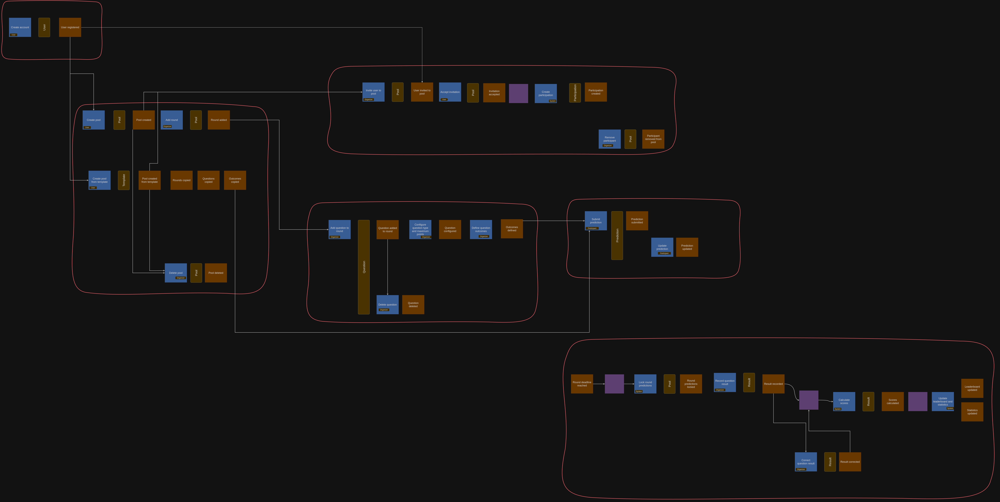

# Design Report — PoolWithFriends

[Iteration 0](#iteration-0) · [Iteration 1](#iteration-1) · [Iteration 2](#iteration-2)

## Iteration 0

### 1. Project overview

PoolWithFriends helps groups of friends run prediction competitions around any
event without money. Organizers define the competition and record results.
Participants submit answers and compare their performance. The system brings
setup, participation, deadlines and results together instead of requiring the
group to coordinate them manually. See the [Iteration 0 vision](iterations/0/i00.d001-vision.md).

The design explores both one-off and recurring competitions, reusable Templates
and different answer types.
The technical boundary is a SvelteKit web application, a Flask API and Supabase
for persistence, with reminders represented as planned functionality.

### 2. Domain discovery and modeling

#### 2.1. EventStorming results

[Open the full-resolution board](diagrams/0/Prediction-Pools-EventStorming-aligned.drawio.png)

The board follows account creation, Pool authoring, invitations and participation,
answer submission, deadlines and result recording through to calculated scores.
Commands such as creating a Pool or submitting an answer lead to domain events.
User, Organizer, Participant and System labels identify who initiates them.
Aggregate labels group responsibilities around Pool, Template, Participation,
Question, Prediction and Result.

The important discoveries are:

- Competition authoring and participation have different responsibilities. A
  participant's answer belongs to a particular question within the competition.
- A Template supplies copied structure, allowing a new Pool to evolve independently.
- Rounds group questions under a deadline. Reaching that deadline initiates locking
  answers, separating prediction time from result recording.
- Recording or correcting a result feeds score calculation and updates to
  leaderboards and statistics. These follow-on policies explain why reporting
  depends on answers and results rather than owning them.

#### 2.2. Domain model

[PlantUML source](diagrams/0/DomainModel.puml)

The conceptual model describes Pools, Rounds, Questions, Outcomes and Predictions,
together with Participation, Templates, Results, Leaderboards and Statistics.
Participation connects a User to a Pool, with one participation per User and Pool
and at most one Prediction per participation and Question. Organizer and
participant are roles, so the organizer can also participate.

A Round belongs to a Pool or a Template, never both. Template-based creation
copies its structure into the Pool. Question specializations distinguish answer
formats. The relationships to Outcomes allow selection-based answers, while
numerical and text values support the other formats. Results and Predictions
feed derived rankings and statistics.

### 3. High-level architecture

[PlantUML source](diagrams/0/components.puml)

The Web UI handles user interaction. SvelteKit server actions and page data form
the Web Application component, which calls the Flask REST API over HTTP/JSON.
The API owns application behavior and accesses Supabase's Data API and PostgreSQL.
The notification component represents planned reminders, not an implemented service.

## Iteration 1

### 1. Project overview

The product remains a zero-money prediction application for friends and
organizers. The [Iteration 1 vision](iterations/1/i01.d001-vision.md) describes
the complete product. The [MVP](iterations/1/i01.d002-mvp.md) narrows the delivery
scope. Pool authoring and participant answers are separate responsibilities in
the Flask modular monolith. The implemented Pool has a shared deadline, while
multiple Rounds remain a future change.

### 2. Domain discovery and modeling

#### 2.1. Domain model

[PlantUML source](diagrams/1/DomainModel.puml)

Question becomes **Bet**, and Prediction becomes **Pick**, including related
operations and labels. Outcome remains a possible answer to a Bet. A Pick records
a participant's answer. The structure and relationships remain unchanged,
including Participation, Round ownership and the answer-format specializations.

### 3. High-level architecture

[PlantUML source](diagrams/1/components.puml)

The component diagram is unchanged. The vocabulary change and the proposal below
fit within the existing components; notifications remain planned.

### 4. Future change scenarios: coupling, cohesion, and design decisions

#### 4.1. Scenario 1 — Multiple Rounds and the interaction between Pools and Picks

##### Change scenario and design context

The application has two related domain areas: **managing competitions** and **recording participants' Picks**. Pool management defines a Pool, its Bets, their possible Outcomes and the deadline for accepting answers. Participation records each User's Pick for a Bet and allows them to change it while answering is open. These responsibilities are implemented in the `pools` and `picks` modules, coordinated by PoolService and PickService within the same Flask application.

In this iteration, every Bet in a Pool shares one deadline. When someone submits a Pick,
PickService asks PoolService for the whole Pool. It then finds the Bet, checks
whether the Pool is open and the Bet is unresolved, and verifies that the chosen
Outcome belongs to that Bet. Although the services are separate, PickService
therefore knows the Pool's internal structure and applies rules belonging to
pool management.

We chose [US29](iterations/1/i01.d003-user-stories.md#us29-organize-multiple-rounds-in-a-pool--later) from the detailed requirements linked by the [MVP](iterations/1/i01.d002-mvp.md). Rounds divide a Pool into named stages, each containing its own Bets and deadline. This lets the organizer keep recurring events within one competition instead of creating a separate Pool each time. For example, a Pool covering a TV show's season could have a Round for each episode, grouping the Bets about that episode. Earlier Picks and results remain part of the same Pool as new Rounds are added. One Round could close while another still accepts Picks. Adding this feature would make the existing dependency more complex: PickService would otherwise need to understand the new Round structure and replace its Pool-wide closing check. Our proposal addresses both the feature and this coupling between responsibilities.

The relevant implementation boundaries are [PoolService](../backend/pools/service.py) and [PickService](../backend/picks/service.py).

##### Coupling and cohesion analysis

**Integration strength.** The current interaction combines model coupling, because PickService understands Pool, Bet and Outcome structures, and functional coupling, because it applies pool-related business rules. The validation operation moves this interaction towards contract coupling: PickService needs to understand the request and its success or rejection, while PoolService owns the rules behind that response. This reduces shared knowledge.

**Distance.** The modules already belong to the same application and deployment, so their structural distance remains low. Keeping Round and Bet authoring together also keeps their necessary joint changes local. An independently deployed Round service would increase distance while retaining dependencies on Pool ownership and Bet availability.

**Volatility.** Competition structure and participation rules belong to our core prediction domain, where further evolution is expected. US29 provides a concrete example of changing deadline rules. The refactoring does not make these business rules less volatile. A later change to deadline ownership could stay within pool management while the validation contract remains stable. Changes to that contract would still affect PickService.

Cohesion improves because PoolService owns competition availability rules and PickService owns participant answers. This follows Khononov's balance because strong relationships remain local within pool management, while less knowledge crosses into the Picks module.

##### Alternatives, decision, and consequences

The options are to keep validation in PickService and teach it the Round structure,
move availability validation behind PoolService, or introduce a separate Round
service. The first option is smaller initially but increases PickService's
knowledge of competition structure. A separate service adds coordination and,
if independently deployed, network and deployment costs without an independent
business boundary.

The proposed decision is to keep Round authoring within pool management and
introduce an explicit validation operation on PoolService when implementing
multiple Rounds in a subsequent sprint.

Round will belong to pool management, with Pool remaining the authoring aggregate
root established by [ADR 0004](adr/0004-pools-contain-bets.md). Pool remains responsible for the organizer's authority and the arrangement of its Rounds, each Round determines when its Bets accept Picks. Existing Pools can be treated as having one Round, and adding another must preserve earlier answers and results. Round uses the same language and ownership rules as Pool and Bet, so this change does not justify a new bounded context.

PickService will ask PoolService whether a Pick is allowed through an explicit
operation, such as `validate_pick_target()`. PoolService will check the Bet's
relationship to the Pool, the Round's deadline, whether the Bet is unresolved
and whether the Outcome is valid. PickService will retain responsibility for
recording or replacing the participant's answer. Reading saved Picks should
also use an interface that hides how Bets are grouped into Rounds.

This keeps changes to competition structure and deadlines together while letting
PickService focus on saving answers. The cost is a new service contract, migration
of existing Pools to a single Round, and updates to authoring, reads and tests.
The contract must define rejection behavior and avoid exposing Round internals.

## Iteration 2

### 1. Project overview

The product vision and principal stakeholders remain unchanged. This iteration
updates the architecture representation to show the existing authentication
integration and analyzes the introduction of open-ended Bets. See the [Iteration 2 vision](iterations/2/i02.d001-vision.md)
and [MVP](iterations/2/i02.d002-mvp.md) for the iteration's product context.

### 2. Domain discovery and modeling

#### 2.1. Domain model

[PlantUML source reused from Iteration 1](diagrams/1/DomainModel.puml)

The vision has not shifted, so Iteration 2 reuses the same domain diagram.
Its concepts, associations and broader scope remain as explained in Iteration 1.
Authentication integration changes the component view, not this conceptual model.

### 3. High-level architecture

[PlantUML source](diagrams/2/components.puml) · [PNG export](diagrams/2/components.png)

This iteration separates **Supabase Auth** from **Supabase Data API + PostgreSQL**
and adds the previously omitted authentication dependencies. The SvelteKit
**server** calls Auth for sign-up, sign-in, session renewal and sign-out. Browser
scripts do not call Supabase directly. The server manages httpOnly session cookies
and forwards the access token to Flask for authenticated application requests.
See [the session hook](../frontend/src/hooks.server.ts) and
[the API client](../frontend/src/lib/server/api.ts).

Both SvelteKit and Flask verify token signatures using Supabase's public signing
keys. Flask fetches and caches those keys, then validates tokens locally rather
than calling Auth for every request, as established by
[ADR 0001](adr/0001-verify-supabase-tokens-locally.md) and implemented in
[the token verifier](../backend/shared/auth.py).

Application-table access still goes through Flask under
[ADR 0003](adr/0003-flask-is-the-only-door-to-app-tables.md). The frontend's Auth
integration does not grant it direct access to application data. Within Flask,
users, pools and picks retain their module boundaries. The scores module derives Records
and Leaderboards through PoolService and PickService. Notifications remain planned.
[The architecture document](architecture.md) details these internal interactions.

This is an update to the documentation of existing behavior, not a new
authentication implementation.

### 4. Future change scenarios: coupling, cohesion, and design decisions

#### 4.1. Scenario 2 — Supporting open-ended Bets alongside multiple-choice Bets

##### Change scenario and design context

The application currently supports Bets with predefined Outcomes. Each Bet has between two and ten options, displayed as radio buttons or a dropdown. These are different presentations of the same answer type. In both cases, a Pick selects exactly one Outcome.

This assumption appears throughout the implementation. [PoolService](../backend/pools/service.py) requires options when creating a Bet. [PickService](../backend/picks/service.py) loads the Pool, finds the Bet, checks its availability and validates that the submitted `outcome_id` belongs to its options. The Pick repository stores that identifier. [ScoreService](../backend/scores/service.py) subsequently compares it with the Bet’s winning Outcome to calculate wins and losses.

[US28 — Create and answer an open-ended Bet](iterations/2/i02.d003-user-stories.md) introduces a different requirement. An organizer should be able to create a Bet without enumerating possible answers, and participants should answer using text. For example, “Who will score first?” could accept a name entered by each participant. This capability already appears as `OpenEndedBet` in the [vision domain model](diagrams/1/DomainModel.puml).

The required behavior is:

- An organizer can create an open-ended Bet without supplying an option list.
- A participant can submit a text answer and retrieve it after reloading.
- Each User still has at most one Pick per Bet and can replace it before the deadline.
- Empty or oversized answers are rejected without replacing an existing valid Pick.
- Identity, deadline and privacy rules apply equally to both answer types. Other participants’ answers remain hidden until the Pool deadline.

This scenario is being considered independently from the round proposal for the last iteration. Our proposal covers authoring, submission, editing and visibility of open ended question in the system.

The feature belongs within the existing prediction bounded context, in our analysis. The `pools`, `picks` and `scores` modules divide responsibilities within that context. Open-ended Bets use the same ownership, participation and deadline rules, so they do not justify a new context. The pools module handles Bet creation and resolution, the picks module records participants’ answers, and the scores module calculates Records and Leaderboards.

##### Coupling and cohesion analysis

**Integration strength.** PickService currently has model coupling to pool management because it understands the structure of Pool, Bet and Outcome. It also has functional coupling because it applies competition rules using that structure, including the Pool’s status and the Bet’s winning Outcome.

Open-ended answers expose another dependency: the assumption that every answer is an Outcome identifier. That assumption connects Bet creation, Pick validation, persistence, API payloads, frontend forms and scoring. Adding a text field to the database alone would therefore be insufficient. Existing validation would reject the answer, and existing response mapping and presentation expect an Outcome.

Separating choice answers from text answers makes their different rules explicit. Format-specific validation can operate behind a small contract that returns a validated answer or a validation error. The shared submission flow then coordinates those checks without containing every format’s rules.

This reduces knowledge of answer-validation details inside the submission flow. It does not eliminate PickService’s existing dependency on the Pool structure. That dependency remains a separate concern addressed by the Iteration 1 proposal.

**Distance.** Distance is low within the backend because its modules share one application and deployment. The relevant boundaries are the `pools`, `picks` and `scores` packages within the same bounded context. Spreading open-ended answer validation across these packages would increase the distance between related rules and require changes in several places. Keeping answer validation together in `picks`, while `pools` defines the Bet’s configuration, keeps related responsibilities close. The frontend/backend boundary introduces greater distance: the SvelteKit forms and Flask API must agree on how choice and text answers are represented.

**Volatility.** We expect answer-validation rules to have low volatility once the text limit and accepted format are defined. These are straightforward rules that are unlikely to change frequently. Keeping them in focused validation functions should therefore be sufficient, without introducing a more elaborate mechanism for interchangeable behavior.

**Cohesion.** Pool management remains responsible for defining what kind of answer a Bet accepts. Pick management remains responsible for recording a User’s answer and replacing it. Validation for each answer format stays together, while identity, deadline and privacy checks remain shared. This avoids duplicating participation rules in separate choice and text submission services.

##### Alternatives, decision, and consequences

One option is to keep the existing Pick model with two optional fields: `outcome_id` for multiple-choice answers and `answer_text` for open-ended answers. A database constraint would ensure that exactly one is filled. The services would check the Bet’s type to decide which field to validate and use. This is a simple approach with few new abstractions, but it can spread answer-specific conditions across several parts of the code, making changes harder to coordinate as more answer types are added.

A second option is to give Pick a single `answer` field containing either a `ChoiceAnswer`, with an Outcome identifier, or a `TextAnswer`, with text. This makes the two answer types explicit in the code, instead of representing them through two optional fields. Both use the same PickService and can still be stored in the same database table. Validation must check that the answer matches the Bet’s type. This approach adds types and conversion code, but prevents an individual answer from containing both text and an Outcome identifier, and also allows implementation of patterns such as strategy, giving different validation for each type of Pick.

A third option is to create separate services for submitting each kind of Pick. Although this separates format-specific behavior, it risks duplicating authentication, deadlines, replacement and privacy rules. Those responsibilities would need coordinated updates whenever participation behavior changed, so we consider this a bad option.

Our proposed decision for the next sprints is to use **distinct answer representations within the existing picks module, with one shared submission flow**, the second option. A choice answer contains an Outcome identifier, and a text answer contains text. Each Pick contains exactly one answer matching its Bet’s declared type.

The Bet’s answer type will be separate from its presentation. Radio buttons and dropdowns remain presentations of a choice Bet. PoolService will validate the configuration appropriate to the type, while PickService will coordinate the common submission rules and delegate format-specific validation to focused functions. Existing Bets will retain choice behavior.

For two simple formats, these functions and an explicit selection by Bet type are sufficient. Strategy becomes useful if validation grows into substantial interchangeable behavior, and is a pattern we are investigating for this implementation.

The costs include extending API payloads, repository mappings, database constraints, frontend forms and acceptance tests. The glossary must also broaden its definitions of Bet and Pick. Existing choice answers must survive the migration unchanged, and tests must verify that both formats obey the same privacy, deadline and replacement rules.

Before implementing text validation, the team must agree on the length limit. Before enabling resolution and scoring for text Bets, it must also agree on correctness criteria. Until that behavior is defined, text answers must not produce wins or losses. This is something TBD for when this stories is developed in the next iteratio.
