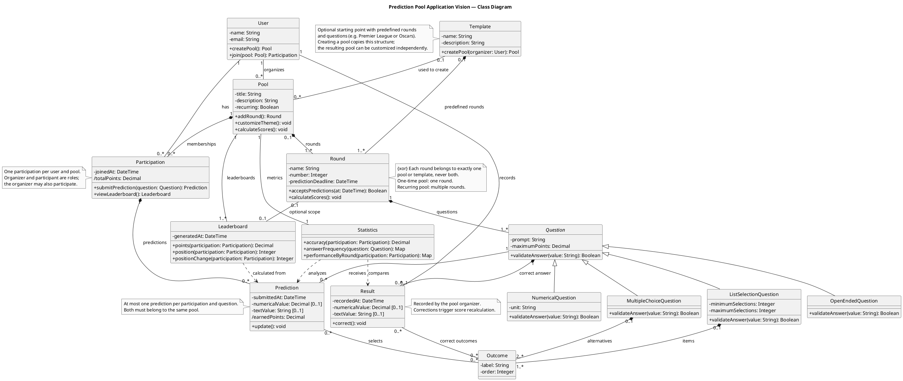
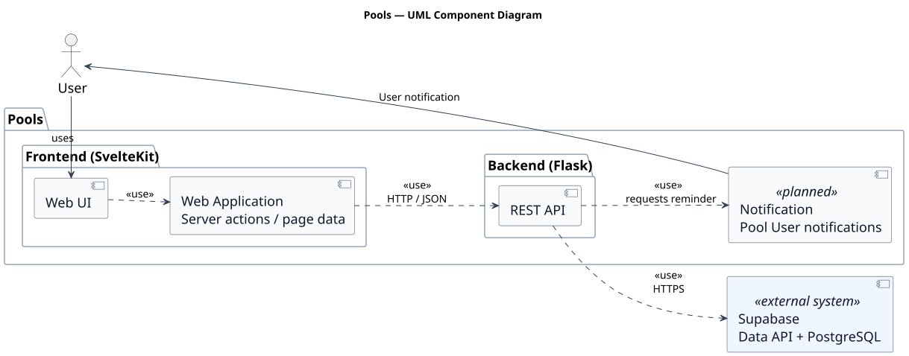

# Design Report — PoolWithFriends

[Iteration 0](#iteration-0) · [Iteration 1](#iteration-1) · [Iteration 2](#iteration-2)

Each iteration follows the report template with the sections applicable at that
stage. Earlier diagrams remain historical snapshots. Domain models describe the
broader product vision, including capabilities beyond the implemented MVP;
[the glossary](../GLOSSARY.md) describes the current application's vocabulary and
rules. Existing patterns and code smells will be documented from Iteration 3.

## Iteration 0

### 1. Project overview

PoolWithFriends helps groups of friends run prediction competitions around any
event without money. Organizers define the competition and record results;
participants submit answers and compare their performance. The system brings
setup, participation, deadlines and results together instead of requiring the
group to coordinate them manually. See the [Iteration 0 vision](iterations/0/i00.d001-vision.md).

The design explores both one-off and recurring competitions, reusable Templates
and different answer types. This scope is broader than the initial implementation.
The technical boundary is a SvelteKit web application, a Flask API and Supabase
for persistence, with reminders represented as planned functionality.

### 2. Domain discovery and modeling

#### 2.1. EventStorming results

[Open the full-resolution board](diagrams/0/Prediction-Pools-EventStorming-aligned.drawio.png)

The board follows account creation, Pool authoring, invitations and participation,
answer submission, deadlines and result recording through to calculated scores.
Commands such as creating a Pool or submitting an answer lead to domain events;
User, Organizer, Participant and System labels identify who initiates them.
Aggregate labels group responsibilities around Pool, Template, Participation,
Question, Prediction and Result.

The important discoveries are:

- Competition authoring and participation have different responsibilities. A
  participant's answer belongs to a particular question within the competition.
- A Template supplies copied structure, allowing a new Pool to evolve independently.
- Rounds group questions under a deadline. Reaching that deadline initiates locking
  answers, separating prediction time from result recording.
- Recording or correcting a result feeds score calculation and updates to
  leaderboards and statistics. These follow-on policies explain why reporting
  depends on answers and results rather than owning them.

The preserved export contains unlabeled policy cards and does not explicitly
identify external systems. Its process connections provide context for the
policies above; the component diagram records the technical integrations.
This is a limitation of the historical workshop artifact against the requested
EventStorming elements, rather than evidence that there are no external dependencies.

#### 2.2. Domain model

[PlantUML source](diagrams/0/DomainModel.puml)

The conceptual model describes Pools, Rounds, Questions, Outcomes and Predictions,
together with Participation, Templates, Results, Leaderboards and Statistics.
Participation connects a User to a Pool, with one participation per User and Pool
and at most one Prediction per participation and Question. Organizer and
participant are roles, so the organizer can also participate.

A Round belongs to a Pool or a Template, never both. Template-based creation
copies its structure into the Pool. Question specializations distinguish answer
formats; the relationships to Outcomes allow selection-based answers, while
numerical and text values support the other formats. Results and Predictions
feed derived rankings and statistics. These are vision concepts and
multiplicities, not a representation of the initial database schema.

### 3. High-level architecture

[PlantUML source](diagrams/0/components.puml)

The Web UI handles user interaction; SvelteKit server actions and page data form
the Web Application component, which calls the Flask REST API over HTTP/JSON.
The API owns application behavior and accesses Supabase's Data API and PostgreSQL.
This boundary keeps persistence access behind the backend and separates browser
presentation from application operations. The notification component represents
planned reminders, not an implemented service.

## Iteration 1

### 1. Project overview

The product remains a zero-money prediction application for friends and
organizers. The [Iteration 1 vision](iterations/1/i01.d001-vision.md) describes
the complete product; the [MVP](iterations/1/i01.d002-mvp.md) narrows the delivery
scope. Pool authoring and participant answers are separate responsibilities in
the Flask modular monolith. The implemented Pool has a shared deadline, while
multiple Rounds remain a future change.

### 2. Domain discovery and modeling

#### 2.1. EventStorming results

The [Iteration 0 board](diagrams/0/Prediction-Pools-EventStorming-aligned.drawio.png)
remains the discovery artifact. Its distinction between competition authoring,
participation and deadline-driven behavior informs the Pool/Pick boundary and
the multiple-Round scenario below. The historical board retains Question and
Prediction terminology; the model now calls them Bet and Pick.

#### 2.2. Domain model

[PlantUML source](diagrams/1/DomainModel.puml)

Question becomes **Bet**, and Prediction becomes **Pick**, including related
operations and labels. Outcome remains a possible answer to a Bet; a Pick records
a participant's answer. The structure and relationships remain unchanged,
including Participation, Round ownership and the answer-format specializations.

The diagram continues to describe the product vision. Points, multiple-selection
Bets and correctable Results express that broader scope. They do not imply those
features are implemented in the MVP, whose current rules use one selected Outcome
per Pick and win/loss Records.

### 3. High-level architecture

[PlantUML source](diagrams/1/components.puml)

The component diagram is unchanged from Iteration 0. SvelteKit handles presentation
and server-side web interactions, Flask handles application operations, and
Supabase supplies persistence. Notifications remain planned. The vocabulary
change and the proposal below fit within these component boundaries.

Within Flask, PoolService coordinates Pool, Bet and Outcome authoring, while
PickService records participant answers. Their interaction is the focus of the
change analysis below. The diagram is preserved as this iteration's snapshot;
the authentication dependency is made explicit in Iteration 2.

### 4. Future change scenarios: coupling, cohesion, and design decisions

#### 4.1. Scenario 1 — Multiple Rounds and the interaction between Pools and Picks

##### Change scenario and design context

The application has two related domain areas: **managing competitions** and **recording participants' Picks**. Pool management defines a Pool, its Bets, their possible Outcomes and the deadline for accepting answers. Participation records each User's Pick for a Bet and allows them to change it while answering is open. These responsibilities are implemented in the `pools` and `picks` modules, coordinated by PoolService and PickService within the same Flask application.

In this iteration, every Bet in a Pool shares one deadline. When someone submits a Pick,
PickService asks PoolService for the whole Pool. It then finds the Bet, checks
whether the Pool is open and the Bet is unresolved, and verifies that the chosen
Outcome belongs to that Bet. Although the services are separate, PickService
therefore knows the Pool's internal structure and applies rules belonging to
pool management.

We chose [US29](iterations/1/i01.d003-user-stories.md#us29-organize-multiple-rounds-in-a-pool--later) from the detailed requirements linked by the [MVP](iterations/1/i01.d002-mvp.md). Rounds divide a Pool into named stages, each containing its own Bets and deadline. This lets the organizer keep recurring events within one competition instead of creating a separate Pool each time. For example, a Pool covering a TV show's season could have a Round for each episode, grouping the Bets about that episode. Earlier Picks and results remain part of the same Pool as new Rounds are added. One Round could close while another still accepts Picks. Adding this feature would make the existing dependency more complex: PickService would otherwise need to understand the new Round structure and replace its Pool-wide closing check. Our proposal addresses both the feature and this coupling between responsibilities.

The relevant implementation boundaries are [PoolService](../backend/pools/service.py) and [PickService](../backend/picks/service.py); these links follow the current code, while this section records the Iteration 1 proposal.

##### Coupling and cohesion analysis

**Integration strength.** The current interaction combines model coupling, because PickService understands Pool, Bet and Outcome structures, and functional coupling, because it applies pool-related business rules. The validation operation moves this interaction towards contract coupling: PickService needs to understand the request and its success or rejection, while PoolService owns the rules behind that response. This reduces shared knowledge.

**Distance.** The modules already belong to the same application and deployment, so their structural distance remains low. Keeping Round and Bet authoring together also keeps their necessary joint changes local. An independently deployed Round service would increase distance while retaining dependencies on Pool ownership and Bet availability.

**Volatility.** Competition structure and participation rules belong to our core prediction domain, where further evolution is expected. US29 provides a concrete example of changing deadline rules. The refactoring does not make these business rules less volatile. A later change to deadline ownership could stay within pool management while the validation contract remains stable. Changes to that contract would still affect PickService.

Cohesion improves because PoolService owns competition availability rules and PickService owns participant answers. This follows Khononov's balance because strong relationships remain local within pool management, while less knowledge crosses into the Picks module.

##### Alternatives, decision, and consequences

The options are to keep validation in PickService and teach it the Round structure,
move availability validation behind PoolService, or introduce a separate Round
service. The first option is smaller initially but increases PickService's
knowledge of competition structure. A separate service adds coordination and,
if independently deployed, network and deployment costs without an independent
business boundary.

The proposed decision is to keep Round authoring within pool management and
introduce an explicit validation operation on PoolService when implementing
multiple Rounds in a subsequent sprint.

Round will belong to pool management, with Pool remaining the authoring aggregate
root established by [ADR 0004](adr/0004-pools-contain-bets.md). Pool remains responsible for the organizer's authority and the arrangement of its Rounds, each Round determines when its Bets accept Picks. Existing Pools can be treated as having one Round, and adding another must preserve earlier answers and results. Round uses the same language and ownership rules as Pool and Bet, so this change does not justify a new bounded context.

PickService will ask PoolService whether a Pick is allowed through an explicit
operation, such as `validate_pick_target()`. PoolService will check the Bet's
relationship to the Pool, the Round's deadline, whether the Bet is unresolved
and whether the Outcome is valid. PickService will retain responsibility for
recording or replacing the participant's answer. Reading saved Picks should
also use an interface that hides how Bets are grouped into Rounds.

This keeps changes to competition structure and deadlines together while letting
PickService focus on saving answers. The cost is a new service contract, migration
of existing Pools to a single Round, and updates to authoring, reads and tests.
The contract must define rejection behavior and avoid exposing Round internals.
This remains a proposal: the current code still uses the Pool structure directly.

## Iteration 2

### 1. Project overview

The product vision and principal stakeholders remain unchanged. This report
increment updates the architecture representation to show the existing
authentication integration explicitly. See the [Iteration 2 vision](iterations/2/i02.d001-vision.md)
and [MVP](iterations/2/i02.d002-mvp.md) for the iteration's product context.

### 2. Domain discovery and modeling

#### 2.1. EventStorming results

The [original workshop board](diagrams/0/Prediction-Pools-EventStorming-aligned.drawio.png)
remains the discovery reference. Making an existing technical authentication
dependency explicit does not change the domain processes or ownership described
in the earlier iterations.

#### 2.2. Domain model

[PlantUML source reused from Iteration 1](diagrams/1/DomainModel.puml)

The vision has not shifted, so Iteration 2 reuses the same domain diagram.
Its concepts, associations and broader scope remain as explained in Iteration 1.
Authentication integration changes the component view, not this conceptual model.

### 3. High-level architecture

[PlantUML source](diagrams/2/components.puml) · [PNG export](diagrams/2/components.png)

This iteration separates **Supabase Auth** from **Supabase Data API + PostgreSQL**
and adds the previously omitted authentication dependencies. The SvelteKit
**server** calls Auth for sign-up, sign-in, session renewal and sign-out; browser
scripts do not call Supabase directly. The server manages httpOnly session cookies
and forwards the access token to Flask for authenticated application requests.
See [the session hook](../frontend/src/hooks.server.ts) and
[the API client](../frontend/src/lib/server/api.ts).

Both SvelteKit and Flask verify token signatures using Supabase's public signing
keys. Flask fetches and caches those keys, then validates tokens locally rather
than calling Auth for every request, as established by
[ADR 0001](adr/0001-verify-supabase-tokens-locally.md) and implemented in
[the token verifier](../backend/shared/auth.py).

Application-table access still goes through Flask under
[ADR 0003](adr/0003-flask-is-the-only-door-to-app-tables.md). The frontend's Auth
integration does not grant it direct access to application data. Within Flask,
users, pools and picks retain their module boundaries; scores derives Records
and Leaderboards through PoolService and PickService. Notifications remain planned.
[The architecture document](architecture.md) details these internal interactions.

This is an update to the documentation of existing behavior, not a new
authentication implementation. Iterations 0 and 1 retain their original diagrams.

The second future-change scenario is pending discussion and is not included in
this increment. Iteration 2's scenario requirement therefore remains outstanding.
