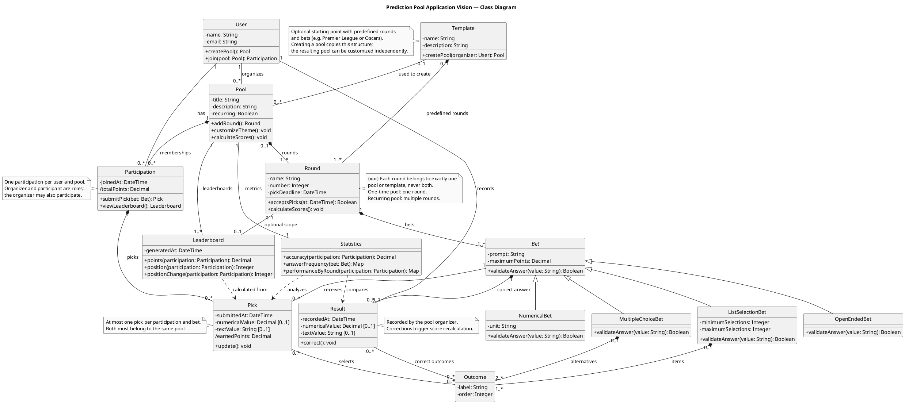
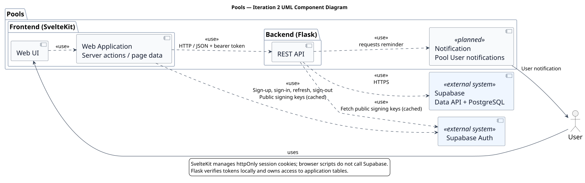
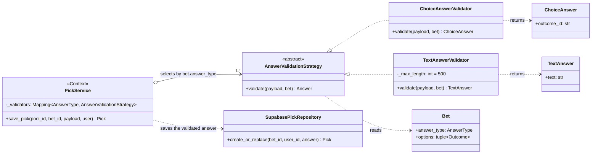

# Design Report — PoolWithFriends

[Iteration 0](#iteration-0) · [Iteration 1](#iteration-1) · [Iteration 2](#iteration-2) · [Iteration 3](#iteration-3)

## Iteration 0

### 1. Project overview

PoolWithFriends helps groups of friends run prediction competitions around any
event without money. Organizers define the competition and record results.
Participants submit answers and compare their performance. The system brings
setup, participation, deadlines and results together instead of requiring the
group to coordinate them manually. See the [Iteration 0 vision](iterations/0/i00.d001-vision.md).

The design explores both one-off and recurring competitions, reusable Templates
and different answer types.
The technical boundary is a SvelteKit web application, a Flask API and Supabase
for persistence, with reminders represented as planned functionality.

### 2. Domain discovery and modeling

#### 2.1. EventStorming results

[Open the full-resolution board](diagrams/0/Prediction-Pools-EventStorming-aligned.drawio.png)

The board follows account creation, Pool authoring, invitations and participation,
answer submission, deadlines and result recording through to calculated scores.
Commands such as creating a Pool or submitting an answer lead to domain events.
User, Organizer, Participant and System labels identify who initiates them.
Aggregate labels group responsibilities around Pool, Template, Participation,
Question, Prediction and Result.

The important discoveries are:

- Competition authoring and participation have different responsibilities. A
  participant's answer belongs to a particular question within the competition.
- A Template supplies copied structure, allowing a new Pool to evolve independently.
- Rounds group questions under a deadline. Reaching that deadline initiates locking
  answers, separating prediction time from result recording.
- Recording or correcting a result feeds score calculation and updates to
  leaderboards and statistics. These follow-on policies explain why reporting
  depends on answers and results rather than owning them.

#### 2.2. Domain model

[PlantUML source](diagrams/0/DomainModel.puml)

The conceptual model describes Pools, Rounds, Questions, Outcomes and Predictions,
together with Participation, Templates, Results, Leaderboards and Statistics.
Participation connects a User to a Pool, with one participation per User and Pool
and at most one Prediction per participation and Question. Organizer and
participant are roles, so the organizer can also participate.

A Round belongs to a Pool or a Template, never both. Template-based creation
copies its structure into the Pool. Question specializations distinguish answer
formats. The relationships to Outcomes allow selection-based answers, while
numerical and text values support the other formats. Results and Predictions
feed derived rankings and statistics.

### 3. High-level architecture

[PlantUML source](diagrams/0/components.puml)

The Web UI handles user interaction. SvelteKit server actions and page data form
the Web Application component, which calls the Flask REST API over HTTP/JSON.
The API owns application behavior and accesses Supabase's Data API and PostgreSQL.
The notification component represents planned reminders, not an implemented service.

## Iteration 1

### 1. Project overview

The product remains a zero-money prediction application for friends and
organizers. The [Iteration 1 vision](iterations/1/i01.d001-vision.md) describes
the complete product. The [MVP](iterations/1/i01.d002-mvp.md) narrows the delivery
scope. Pool authoring and participant answers are separate responsibilities in
the Flask modular monolith. The implemented Pool has a shared deadline, while
multiple Rounds remain a future change.

### 2. Domain discovery and modeling

#### 2.1. Domain model

[PlantUML source](diagrams/1/DomainModel.puml)

Question becomes **Bet**, and Prediction becomes **Pick**, including related
operations and labels. Outcome remains a possible answer to a Bet. A Pick records
a participant's answer. The structure and relationships remain unchanged,
including Participation, Round ownership and the answer-format specializations.

### 3. High-level architecture

[PlantUML source](diagrams/1/components.puml)

The component diagram is unchanged. The vocabulary change and the proposal below
fit within the existing components; notifications remain planned.

### 4. Future change scenarios: coupling, cohesion, and design decisions

#### 4.1. Scenario 1 — Multiple Rounds and the interaction between Pools and Picks

**First documented:** 2026-11-08. (commit 207e0cb)

##### Change scenario and design context

The application has two related domain areas: **managing competitions** and **recording participants' Picks**. Pool management defines a Pool, its Bets, their possible Outcomes and the deadline for accepting answers. Participation records each User's Pick for a Bet and allows them to change it while answering is open. These responsibilities are implemented in the `pools` and `picks` modules, coordinated by PoolService and PickService within the same Flask application.

In this iteration, every Bet in a Pool shares one deadline. When someone submits a Pick,
PickService asks PoolService for the whole Pool. It then finds the Bet, checks
whether the Pool is open and the Bet is unresolved, and verifies that the chosen
Outcome belongs to that Bet. Although the services are separate, PickService
therefore knows the Pool's internal structure and applies rules belonging to
pool management.

We chose [US29](iterations/1/i01.d003-user-stories.md#us29-organize-multiple-rounds-in-a-pool--later) from the detailed requirements linked by the [MVP](iterations/1/i01.d002-mvp.md). Rounds divide a Pool into named stages, each containing its own Bets and deadline. This lets the organizer keep recurring events within one competition instead of creating a separate Pool each time. For example, a Pool covering a TV show's season could have a Round for each episode, grouping the Bets about that episode. Earlier Picks and results remain part of the same Pool as new Rounds are added. One Round could close while another still accepts Picks. Adding this feature would make the existing dependency more complex: PickService would otherwise need to understand the new Round structure and replace its Pool-wide closing check. Our proposal addresses both the feature and this coupling between responsibilities.

The relevant implementation boundaries are [PoolService](../backend/pools/service.py) and [PickService](../backend/picks/service.py).

##### Coupling and cohesion analysis

**Integration strength.** The current interaction combines model coupling, because PickService understands Pool, Bet and Outcome structures, and functional coupling, because it applies pool-related business rules. The validation operation moves this interaction towards contract coupling: PickService needs to understand the request and its success or rejection, while PoolService owns the rules behind that response. This reduces shared knowledge.

**Distance.** The modules already belong to the same application and deployment, so their structural distance remains low. Keeping Round and Bet authoring together also keeps their necessary joint changes local. An independently deployed Round service would increase distance while retaining dependencies on Pool ownership and Bet availability.

**Volatility.** Competition structure and participation rules belong to our core prediction domain, where further evolution is expected. US29 provides a concrete example of changing deadline rules. The refactoring does not make these business rules less volatile. A later change to deadline ownership could stay within pool management while the validation contract remains stable. Changes to that contract would still affect PickService.

Cohesion improves because PoolService owns competition availability rules and PickService owns participant answers. This follows Khononov's balance because strong relationships remain local within pool management, while less knowledge crosses into the Picks module.

##### Alternatives, decision, and consequences

The options are to keep validation in PickService and teach it the Round structure,
move availability validation behind PoolService, or introduce a separate Round
service. The first option is smaller initially but increases PickService's
knowledge of competition structure. A separate service adds coordination and,
if independently deployed, network and deployment costs without an independent
business boundary.

The proposed decision is to keep Round authoring within pool management and
introduce an explicit validation operation on PoolService when implementing
multiple Rounds in a subsequent sprint.

Round will belong to pool management, with Pool remaining the authoring aggregate
root established by [ADR 0004](adr/0004-pools-contain-bets.md). Pool remains responsible for the organizer's authority and the arrangement of its Rounds, each Round determines when its Bets accept Picks. Existing Pools can be treated as having one Round, and adding another must preserve earlier answers and results. Round uses the same language and ownership rules as Pool and Bet, so this change does not justify a new bounded context.

PickService will ask PoolService whether a Pick is allowed through an explicit
operation, such as `validate_pick_target()`. PoolService will check the Bet's
relationship to the Pool, the Round's deadline, whether the Bet is unresolved
and whether the Outcome is valid. PickService will retain responsibility for
recording or replacing the participant's answer. Reading saved Picks should
also use an interface that hides how Bets are grouped into Rounds.

This keeps changes to competition structure and deadlines together while letting
PickService focus on saving answers. The cost is a new service contract, migration
of existing Pools to a single Round, and updates to authoring, reads and tests.
The contract must define rejection behavior and avoid exposing Round internals.

## Iteration 2

### 1. Project overview

The product vision and principal stakeholders remain unchanged. This iteration
updates the architecture representation to show the existing authentication
integration and analyzes the introduction of open-ended Bets. See the [Iteration 2 vision](iterations/2/i02.d001-vision.md)
and [MVP](iterations/2/i02.d002-mvp.md) for the iteration's product context.

### 2. Domain discovery and modeling

#### 2.1. Domain model

[PlantUML source reused from Iteration 1](diagrams/1/DomainModel.puml)

The vision has not shifted, so Iteration 2 reuses the same domain diagram.
Its concepts, associations and broader scope remain as explained in Iteration 1.
Authentication integration changes the component view, not this conceptual model.

### 3. High-level architecture

[PlantUML source](diagrams/2/components.puml) · [PNG export](diagrams/2/components.png)

This iteration separates **Supabase Auth** from **Supabase Data API + PostgreSQL**
and adds the previously omitted authentication dependencies. The SvelteKit
**server** calls Auth for sign-up, sign-in, session renewal and sign-out. Browser
scripts do not call Supabase directly. The server manages httpOnly session cookies
and forwards the access token to Flask for authenticated application requests.
See [the session hook](../frontend/src/hooks.server.ts) and
[the API client](../frontend/src/lib/server/api.ts).

Both SvelteKit and Flask verify token signatures using Supabase's public signing
keys. Flask fetches and caches those keys, then validates tokens locally rather
than calling Auth for every request, as established by
[ADR 0001](adr/0001-verify-supabase-tokens-locally.md) and implemented in
[the token verifier](../backend/shared/auth.py).

Application-table access still goes through Flask under
[ADR 0003](adr/0003-flask-is-the-only-door-to-app-tables.md). The frontend's Auth
integration does not grant it direct access to application data. Within Flask,
users, pools and picks retain their module boundaries. The scores module derives Records
and Leaderboards through PoolService and PickService. Notifications remain planned.
[The architecture document](architecture.md) details these internal interactions.

This is an update to the documentation of existing behavior, not a new
authentication implementation.

### 4. Future change scenarios: coupling, cohesion, and design decisions

#### 4.1. Scenario 2 — Supporting open-ended Bets alongside multiple-choice Bets

**First documented:** 2026-11-20.

##### Change scenario and design context

An organizer running a football prediction Pool may want to ask “Who will
score first?” without listing every possible player. [US28](iterations/2/i02.d003-user-stories.md#us28-create-and-answer-an-open-ended-bet--later)
describes this feature, and the [vision domain model](diagrams/1/DomainModel.puml)
already includes `OpenEndedBet`. This scenario uses the current shared Pool
deadline and can be implemented independently of the Rounds proposal.

Today, each Bet has two to ten predefined Outcomes. Radio buttons and dropdowns
are two presentations of the same choice format. `PoolService` validates the
option list when creating a Bet. `PickService` loads the Pool, finds the Bet,
checks whether it accepts Picks, and verifies that the submitted `outcome_id`
belongs to it. The repository stores the Outcome ID, and `ScoreService`
compares it with the winning Outcome when computing Records.
[PoolService](../backend/pools/service.py) · [PickService](../backend/picks/service.py) · [Pick repository](../backend/picks/repository.py) · [ScoreService](../backend/scores/service.py)

The first implementation will let organizers create a text Bet without an
option list and let participants submit, retrieve, and replace a text Pick.
Both formats follow the same rules for identity, deadline, and visibility.
Each User has at most one Pick per Bet. A blank, oversized, or otherwise
invalid answer leaves the previous Pick intact. Before the deadline, a User
can read only their own Picks. From the deadline onward, the existing reveal
rule applies to both formats.

##### Coupling and cohesion analysis

**Strength.** `PickService` is coupled to the Pool and Bet models because it
traverses `pool.bets` and reads Bet options and resolution state. It also relies
on their behavior to decide whether a Pick can be saved. A second dependency
is the assumption that every answer is an Outcome ID. That assumption connects
authoring, submission, persistence, API serialization, frontend rendering, and
scoring. Representing `ChoiceAnswer` and `TextAnswer` explicitly and placing
format-specific validation behind an `AnswerValidationStrategy` contract lets
the shared submission flow depend on a validation operation and its result.
Each strategy owns the rules for its answer format. `PickService` still depends
on Pool structure, and the strategies need the Bet's answer configuration.
The two modules also need to agree on the Bet's declared answer type.

**Distance.** `pools`, `picks`, and `scores` run in the same Flask application
and can be changed together. Keeping answer validation inside `picks` limits
the number of modules involved when a format rule changes. The answer
representation also crosses the HTTP boundary. Flask serializers, OpenAPI,
SvelteKit types, form actions, and components must agree on the payload and
response fields. Keeping the existing choice payload reduces coordination for
current clients. Adding text still requires a database migration and changes
on both sides of the API.
[OpenAPI](iterations/2/i02.d007.openapi.yaml) · [Frontend types](../frontend/src/lib/types.ts) · [Bet form](../frontend/src/lib/components/BetForm.svelte) · [Bet card](../frontend/src/lib/components/BetCard.svelte)

**Volatility.** Volatility is the likelihood that a component will need to
change over time. We expect answer-format validation to have higher volatility
than the shared Pick submission flow. US28 leaves text limits open, so the text
validator is likely to change as the team agrees on accepted input. The vision
also includes numerical and list-selection Bets, making additional validators
plausible. Choice validation has lower expected volatility because the existing
rule that an Outcome must belong to its Bet is already defined and tested.

The one-Pick-per-User-and-Bet invariant and identity checks have lower expected
volatility because the planned formats use the same participation rules.
Deadline and visibility logic may change when Rounds are introduced, as analyzed
in Scenario 1. Resolution and scoring are likely to change when the team defines
how text answers are judged. API serializers, frontend forms and repository
mappings will change when a new answer format is introduced, while adjustments
to an existing format's validation should usually stay within its strategy,
tests and any matching UI hints. These are qualitative expectations based on
the backlog and unresolved requirements. The Strategy contract is intended to
keep the common submission flow stable as format-specific rules evolve, at the
cost of maintaining that contract and the selection of strategies.

**Cohesion.** The `pools` module defines which answer format a Bet accepts and
validates its configuration. The `picks` module validates and stores a User's
answer and owns the common submission and visibility rules. The `scores`
module calculates Records and ranks. Keeping one submission flow gives
both formats the same identity, deadline, and replacement behavior.

##### Alternatives, decision, and consequences

1. **Use two optional fields directly on the domain Pick.** This is the
   smallest model change. Every consumer must interpret which field is
   present, and the model needs an invariant to reject Picks with both
   fields populated or both empty.
2. **Use one typed answer on the domain Pick and one submission flow.**
   A Pick contains either `ChoiceAnswer` or `TextAnswer`. This makes the
   valid shapes explicit and adds mapping code at the API and persistence
   boundaries. Format validation can use functions selected inside PickService
   or Strategy implementations behind one interface. Functions have less setup
   for two formats. Strategy localizes changes as formats gain different rules,
   but adds an interface, implementations and a selection mechanism.
3. **Use separate submission services for choice and text.** Each service
   could evolve independently, but both need the same identity, deadline,
   replacement, and privacy rules. With two simple formats, the additional
   coordination outweighs that benefit.

**Decision for the next implementation sprint.** Choose option 2. Introduce
a Bet answer type (`choice` or `text`) independently of its presentation,
and give Pick one typed `answer`. Keep one `PickService` and apply the
**Strategy pattern** to answer validation within the `picks` module. Define
an `AnswerValidationStrategy` interface with an operation such as
`validate(payload, bet_configuration) -> Answer`, returning a validated
`ChoiceAnswer` or `TextAnswer` or raising the existing `ValidationError`.
`ChoiceAnswerValidator` checks that the supplied Outcome belongs to the Bet.
`TextAnswerValidator` trims text and checks the limit agreed by the team before
implementation. A mapping from Bet type to validator selects the strategy.
An unsupported type produces a validation error before any Pick is saved.

PickService keeps the common identity, availability and replacement checks,
invokes the selected strategy, and passes the validated answer to its
repository. PoolService continues to validate Bet configuration when authoring.
This choice follows the expected evolution toward further Bet types and gives
each format one place for its validation rules. The extra interface and
selection mapping add complexity for the initial two formats. A new format
requires a strategy and a mapping entry, together with API, storage and UI
support. A change to the shared validation contract can affect every strategy.

Keep the existing `outcome_id` field in choice requests and responses.
Add `answer_text` for text requests and responses. Reject requests that
supply both fields, supply neither, or use the wrong field for the Bet type.
In PostgreSQL, keep both formats in the existing Picks table, enforce that
exactly one answer column is populated, and retain the foreign key for
choice Outcomes and the uniqueness of `(bet_id, user_id)`. Mark existing
Bets as `choice` and preserve their Picks and winning Outcomes. The
repository maps the two storage columns to the typed domain answer.
[Pick repository](../backend/picks/repository.py) · [Schema migration](../backend/migrations/20261104210948_pool_contains_bets.sql)

The first release will support creation, submission, editing, and reveal
for text Bets. While the team defines how to judge equivalent text answers,
the Resolve endpoint will reject text Bets and their Picks will contribute
zero wins and zero losses. A User with only a text Pick can still appear
with a `0/0` Record, as a User with only an unresolved choice Pick can today.
The cost of this staged delivery is that organizers can collect and reveal
text answers before they can score them.

The sprint acceptance checks will cover creation without options, saving
and reloading a text Pick, preserving the previous answer after an invalid
replacement, and revealing both answer formats at the same deadline.
Each strategy will have focused tests for valid and invalid answers. Submission
tests will check selection by Bet type and that a validation error preserves
the saved Pick.
An existing choice Bet and its saved Picks must still work through the
same API after migration.

## Iteration 3

### 5. Design patterns

#### 5.1. Strategy — validating a Pick's answer by the Bet's answer type

**Story:** [US28 Create and answer an open-ended Bet](https://github.com/MESW-LES-2627/les-project-group-8/issues/179).
**Follows:** the decision in [Scenario 2](#41-scenario-2--supporting-open-ended-bets-alongside-multiple-choice-bets).

##### Problem in context

Before US28, every answer was the id of one of the Bet's Outcomes.
`PickService.save_pick` ran the rules every Pick shares and then checked the
`outcome_id` inline, as its last step before writing
([`save_pick` before US28, lines 55–61](https://github.com/MESW-LES-2627/les-project-group-8/blob/5457dfb58ed400ece87c899bdf5ea5475524d15e/backend/picks/service.py#L55-L61)).
The shared rules are: the participant is the logged-in User, the Bet belongs to
the Pool, the Pool is open, and the Bet is unresolved.

US28 adds text Bets, whose answers follow different rules. A text answer is
trimmed, must be 1–500 Unicode code points, is kept as plain text, and must not
come with an `outcome_id`. Everything else stays the same for both formats:
identity (AC 28.10), the deadline (AC 28.7), replacing only your own Pick
(AC 28.6) and privacy until the deadline (AC 28.8). An invalid answer must leave
the saved one unchanged (AC 28.5).

The design problem is where the format-specific rules should live. The
submission flow carries the identity, deadline and replacement rules already
tested by US10, US15 and US16. It should not be edited each time a format is
added or a format's rule changes. Scenario 2 expects both kinds of change: the
text limit was open until refinement, and the vision lists numeric and list
Bets. The validated answer must also exist before the repository is called,
so that a rejected answer can never overwrite a saved one.

##### The pattern

We applied **Strategy** ([Refactoring.Guru](https://refactoring.guru/design-patterns/strategy);
Gamma et al., *Design Patterns*, 1994). What varies is one algorithm, "turn this
request body into a valid answer for this Bet". It is chosen per request from
data (`bet.answer_type`), and the steps around it are the same for every format.
`PickService` runs the shared checks, asks the strategy for the answer type to
validate the body, and passes the typed result to the repository. It does not
know any format's rules.

| Strategy role | Our element | Where |
| :- | :- | :- |
| Strategy | `AnswerValidationStrategy`, an abstract base class (`abc.ABC`) with the abstract method `validate(payload, bet) -> Answer` | [answers.py:22](../backend/picks/answers.py) |
| Concrete strategy | `ChoiceAnswerValidator(AnswerValidationStrategy)`: the `outcome_id` must be one of `bet.options`; `answer_text` is refused | [answers.py:30](../backend/picks/answers.py) |
| Concrete strategy | `TextAnswerValidator(AnswerValidationStrategy)`: trim, 1–`max_length` (500) code points; `outcome_id` is refused | [answers.py:43](../backend/picks/answers.py) |
| Context | `PickService`, holding a `Mapping[AnswerType, AnswerValidationStrategy]` | [service.py:16–25](../backend/picks/service.py) |
| Context → Strategy call | `save_pick` looks up `self._validators[bet.answer_type]` and calls `validate` after the shared checks and before `create_or_replace` | [service.py:65–71](../backend/picks/service.py) |
| Client that configures the context | `create_app` passes `default_answer_validators()` into `PickService` | [answers.py:60](../backend/picks/answers.py), [app.py:43](../backend/app.py) |
| Data passed to the strategy | The `Bet` (its `options` and `answer_type`) | [pools/models.py:15](../backend/pools/models.py) |
| Strategy results | `ChoiceAnswer` and `TextAnswer`, stored as `Pick.answer` | [picks/models.py:10–23](../backend/picks/models.py) |

*Figure: the Strategy pattern as it appears in the `picks` module.*
[PlantUML source](diagrams/3/answer-validation-strategy.puml)

Two choices follow from Python, which has no `interface` keyword. The
Strategy is an abstract base class: `AnswerValidationStrategy` subclasses
`abc.ABC` and marks `validate` with `@abstractmethod`. Each concrete validator
declares that it implements the interface by subclassing it, which is the
realization arrow in the figure. Python refuses to instantiate the interface
itself, or any subclass that leaves `validate` unimplemented, with a
`TypeError`. The concrete strategies inherit no behavior,
only the contract, and `PickService` uses them through composition: it holds
them in a mapping injected through the constructor, not through subclassing.
The mapping, not a factory method on the Bet, also keeps `pools` from
importing anything from `picks`.

Evidence: [US28 acceptance tests](../backend/tests/acceptance/test_us28_open_ended.py),
which go through both strategies via the HTTP API, following the team's
[testing approach](iterations/3/i03.d004-testing.md#testing-policy).

##### Consequences and alternatives

**What the pattern gave us.**

- *Changes stayed local.* Adding text answers replaced five lines at the end of
  `save_pick` with four; none of its shared checks changed, and the US10, US15
  and US16 tests passed after only the stored-answer assertions were updated.
  Changing the text limit now touches only `TextAnswerValidator` and the
  AC 28.4/28.5 examples.
- *AC 28.5 holds for any format.* A strategy either returns an answer or
  raises. `create_or_replace` only runs with a returned answer, so a rejected
  answer never reaches the database; the AC 28.5 tests check that the saved
  answer survives.
- *Typed results.* The repository ([`_answer_columns`](../backend/picks/repository.py))
  and `ScoreService` match on `ChoiceAnswer`/`TextAnswer` instead of checking
  which nullable field is set.

**What it cost.**

- *Indirection.* `save_pick` no longer shows what a valid choice answer is: a
  reader has to follow the mapping into `answers.py`.
- *Two lists must agree.* `AnswerType` is defined in `pools` and the mapping in
  `picks`. A new enum value without a strategy fails per request with a 400,
  not at startup. In practice a new type arrives with its own acceptance
  tests, which would fail on that 400.
- *It only covers validation.* Bet authoring (`parse_new_bet`), the
  repository's column mapping, JSON serialization, scoring and the Svelte
  components still branch on the answer type. A new format still touches about
  six places. We kept those as simple conditionals, because one polymorphic
  "answer format" class handling validation, storage, serialization and scoring
  would tie `pools`, `picks` and `scores` to a single hierarchy.
- *Marginal with two formats.* A dict of two functions would behave the same.
  The class form pays off mainly by naming the contract and making each
  format's rules one place to read; it does not yet pay off in volume.

**Alternatives we considered.**

| | Strategy (chosen) | `if/elif` on `answer_type` in `save_pick` | Polymorphic `Bet` subclasses (`TextBet.validate_answer`) |
| :- | :- | :- | :- |
| Adding a format | New class and mapping entry; `save_pick` unchanged | Edit `save_pick`, next to the identity and deadline rules | New `Bet` subclass in `pools` |
| Changing the text limit | `TextAnswerValidator` only | Inside `save_pick` | Inside `pools` |
| Module dependencies | `picks` → `pools` (unchanged) | Unchanged | `pools` would need `picks`' answer types: a `pools` ↔ `picks` cycle |
| Reading the flow | Two files | One method | Two modules |
| Size today | 1 protocol, 2 classes, 1 mapping | About 15 lines added to `save_pick` | Bet hierarchy and repository mapping per subclass |

The `if/elif` version is the credible competitor. It is simpler to read and
would have been enough for US28 alone. We rejected it because every future
format or rule change would edit the method that enforces identity and the
deadline, which are the rules with the most acceptance tests behind them, and
because the field-exclusion rules for each format would sit side by side in one
method. Polymorphic Bets were rejected because validating a Pick is the `picks`
module's job, and moving it into `Bet` would reverse the dependency between the
modules. Separate submission services per format were ruled out in Scenario 2:
they would duplicate the shared rules.
