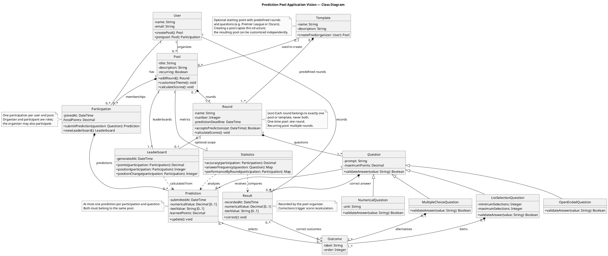
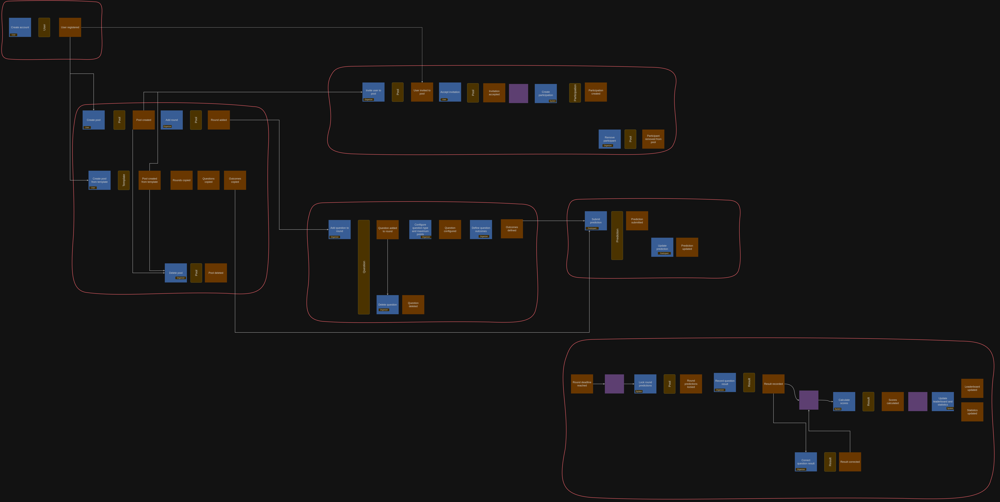
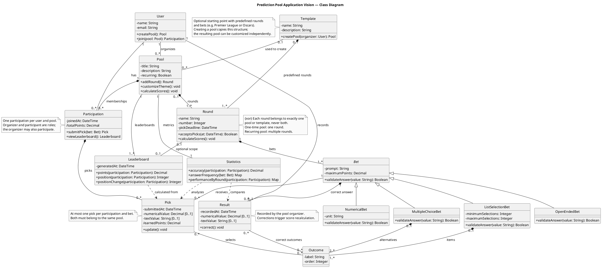
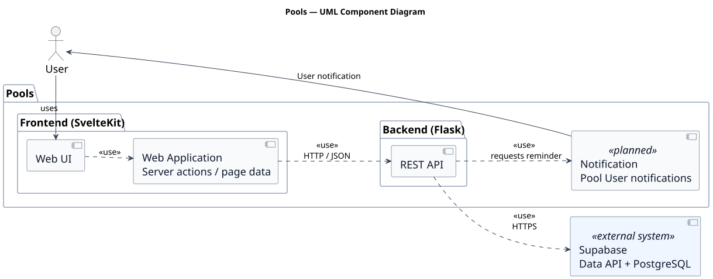

# Design

[Iteration 0](#iteration-0) · [Iteration 1](#iteration-1)

## Iteration 0

### Domain model

[PlantUML source](diagrams/0/DomainModel.puml)

The model describes Pools, Rounds, Questions, Outcomes and Predictions, together
with Templates, Results and rankings. It represents the product vision developed
further in the [vision document](iterations/1/i01.d001-vision.md), beyond the
features implemented so far.

### Component diagram

[PlantUML source](diagrams/0/components.puml)

The SvelteKit frontend calls the Flask API, which accesses Supabase. The diagram
also includes the planned notification component for reminders.

### Event storming

[Open the aligned draw.io export](diagrams/0/Prediction-Pools-EventStorming-aligned.drawio.png)

This version follows pool creation, participation, predictions, round deadlines
and result recording through to scores and statistics.

## Iteration 1

### Domain model

[PlantUML source](diagrams/1/DomainModel.puml)

Question becomes **Bet**, and Prediction becomes **Pick**, including related operations and labels, matching the code's vocabulary. Outcome remains a possible answer to a Bet, a Pick records a participant's answer. The structure and relationships remain unchanged.

### Component diagram

[PlantUML source](diagrams/1/components.puml)

The component diagram is unchanged. The vocabulary change and the proposal below
fit within the existing components; notifications remain planned.

### Future change: multiple rounds and the interaction between Pools and Picks

The application has two related domain areas, that are **managing competitions** and **recording participants' predictions**. Pool management defines a Pool, their Bets, their possible Outcomes and when answers are accepted ( their deadline ). Prediction participation records each User's Pick for a Bet and allows them to change it while answering is open. These responsibilities are implemented in the `pools` and `picks` modules, coordinated by PoolService and PickService within the same Flask application.

Today, every Bet in a Pool shares one deadline. When someone submits a Pick,
PickService asks PoolService for the whole Pool. It then finds the Bet, checks
whether the Pool is open and the Bet is unresolved, and verifies that the chosen
Outcome belongs to that Bet. Although the services are separate, PickService
therefore knows the Pool's internal structure and applies rules belonging to
pool management.

We chose [US29](iterations/1/i01.d003-user-stories.md#us29-organize-multiple-rounds-in-a-pool--later) from the detailed requirements linked by the [MVP](iterations/1/i01.d002-mvp.md). Rounds divide a Pool into named stages, each containing its own Bets and deadline. This lets the organizer keep recurring events within one competition instead of creating a separate Pool each time. For example, a Pool covering a TV show's season could have a Round for each episode, grouping the Bets about that episode. Earlier Picks and results remain part of the same Pool as new Rounds are added. One Round could close while another still accepts Picks. Adding this feature would make the existing dependency more complex: PickService would otherwise need to understand the new Round structure and replace its Pool-wide closing check. Our proposal addresses both the feature and this coupling between responsibilities.

#### Design decisions

Round will belong to pool management, with Pool remaining the authoring aggregate
root established by [ADR 0004](adr/0004-pools-contain-bets.md). Pool remains responsible for the organizer's authority and the arrangement of its Rounds, each Round determines when its Bets accept Picks. Existing Pools can be treated as having one Round, and adding another must preserve earlier answers and results. Round uses the same language and ownership rules as Pool and Bet, so this change does not justify a new bounded context.

PickService will ask PoolService whether a Pick is allowed through an explicit
operation, such as `validate_pick_target()`. PoolService will check the Bet's
relationship to the Pool, the Round's deadline, whether the Bet is unresolved
and whether the Outcome is valid. PickService will retain responsibility for
recording or replacing the participant's answer. Reading saved Picks should
also use an interface that hides how Bets are grouped into Rounds.

#### Coupling and cohesion

**Integration strength.** The current interaction combines model coupling, because PickService understands Pool, Bet and Outcome structures, and functional coupling, because it applies pool-related business rules. The validation operation moves this interaction towards contract coupling: PickService needs to understand the request and its success or rejection, while PoolService owns the rules behind that response. This reduces shared knowledge.

**Distance.** The modules already belong to the same application and deployment, so their structural distance remains low. Keeping Round and Bet authoring together also keeps their necessary joint changes local. An independently deployed Round service would increase distance while retaining dependencies on Pool ownership and Bet availability.

**Volatility.** Competition structure and participation rules belong to our core prediction domain, where further evolution is expected. US29 provides a concrete example of changing deadline rules. The refactoring does not make these business rules less volatile.  A later change to deadline ownership could stay within pool management while the validation contract remains stable. Changes to that contract would still affect PickService.

Cohesion improves because PoolService owns competition availability rules and PickService owns participant answers. This follows Khononov's balance because strong relationships remain local within pool management, while less knowledge crosses into the Picks module.
