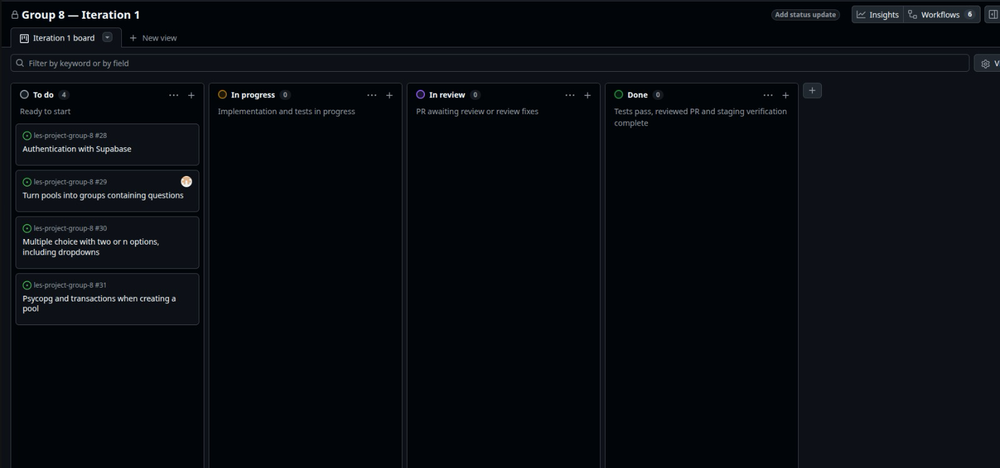
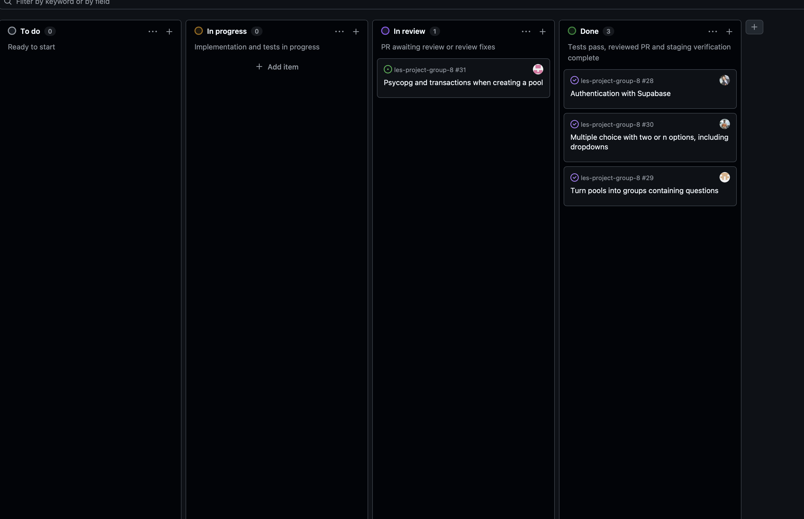

# Retrospective

We had a reasonable amount of issues. This time we managed to streamline our workflows with fewer conflicts following the process of PRs, and we got timely reviews.

**Initial board:**

**Final board:**

We managed to implement the major issues we sought out to do, except one which got held back even though there is an implementation already. But we didn't get time to review.

This iteration suffered from what I'll call "vertical" issues that lead to all layers of code needing to be changed. We couldn't finish all issues, probably because the issues were made in a way that did not allow for parallel work.

For the next iteration we should work out interfaces for the modules that are going to be responsible for the issues, frame the issues with the goal of working independently. That way each one of us just needs to implement the interface and call the interface of the dependency.

We must also improve group integration. We had problems coordinating all members. We have to improve our communication. We're trying to use Discord with channels to organize conversations, but we're still having problems adhering to that. The fact that we started using WhatsApp makes it hard to move against that inertia.

