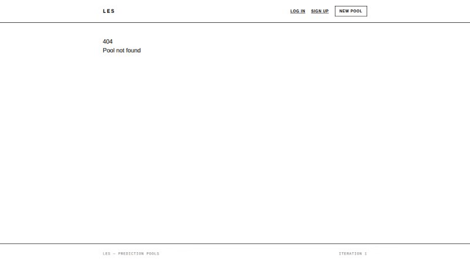
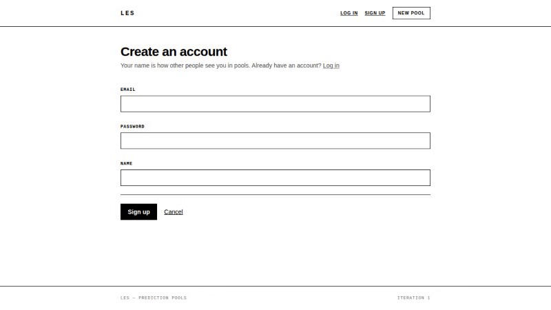
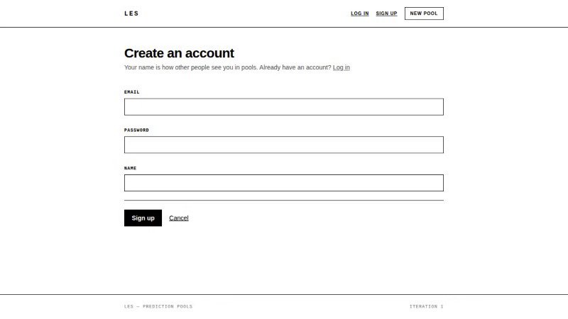
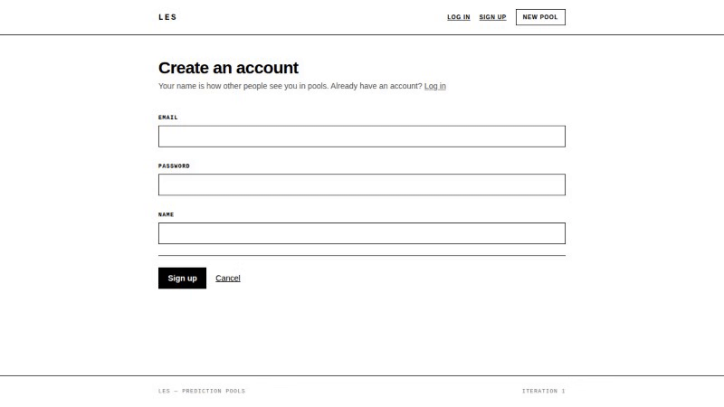
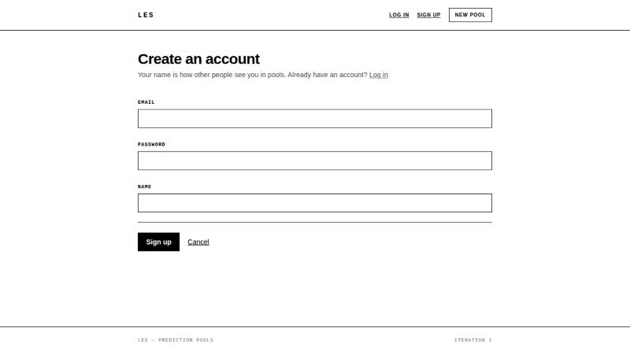

# Story gallery

One GIF per user story, recorded from `frontend/e2e/stories.story.ts` at 2c022bced4fdf6436c60230333b8cbaf17bc6094.
Rewritten by `.github/workflows/stories.yml` on each push to `staging` and each manual run.

## US1: Create an account

## US2: Create a two-option pool

## US3: See the pools

## US5: See who I am

## US6: Set a deadline in my local time

## US7: Share a pool link

## US8: Open a single pool

## US9: See a pool’s status on its page

## US10: Pick an outcome

## US11: Change my pick before the deadline

## US12: See my own pick

## US13: Be refused a pick after the deadline

## US15: See everyone’s picks after the deadline

## US16: Not see others’ picks before the deadline

## US17: Resolve a Bet by choosing the winner

## US18: Resolve only as the decider

## US19: Resolve only after the deadline

## US20: Resolve a Bet only once

## US22: See my wins and losses

## US23: See the correct pickers on a resolved Bet

## US24: See another user’s record in a pool

## US25: Create a pool as a group of Bets

## US26: Create a multiple-choice Bet with n options

## US27: Display multiple choice as a dropdown

## US31: See a pool’s leaderboard

